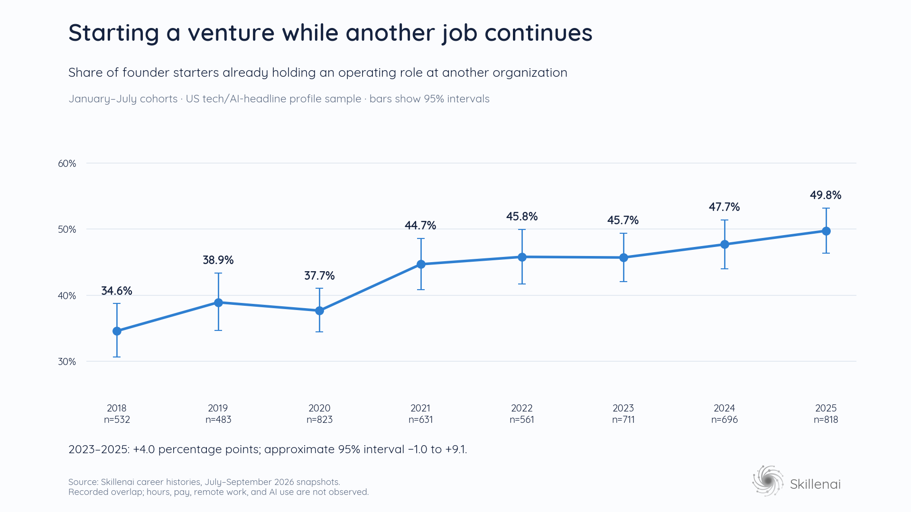

# Becoming a Founder Doesn't Always Mean Quitting Your Job

*October 29, 2026 · Skillenai career-profile analysis · January–July cohorts*

Starting a company can mean keeping the job you already have. In Skillenai's sampled career histories, about half the people who started a founder role in early 2025 already held another operating job at a different organization.

That matters when interpreting the growth of “Founder” as a job title. A new founder entry can represent a new business, a side project, a consulting practice, or an additional professional identity. It does not necessarily represent someone moving out of employment and into full-time entrepreneurship.

A [recent Live Data Technologies analysis](https://lnkd.in/p/gZMnzN6g) raised the question of what founder-title growth actually counts. Skillenai's career-profile data adds another dimension: the other job a person held when the founder title began.

## Many founder roles begin alongside an existing job

Among 818 people whose first recorded founder-role start within January–July 2025 could be dated to a month, 407 already held another operating role: **49.8%**. Another role counted only if it began before the founder-start month and ended after it, at a different organization.

The same measure was 45.7% in January–July 2023 and 34.6% in the corresponding months of 2018.

| Founder-start period | People starting a founder role | Already held another operating job | Already held any other non-founder role |
|---|---:|---:|---:|
| Jan–Jul 2018 | 532 | 34.6% | 43.6% |
| Jan–Jul 2019 | 483 | 38.9% | 47.4% |
| Jan–Jul 2020 | 823 | 37.7% | 45.1% |
| Jan–Jul 2021 | 631 | 44.7% | 52.9% |
| Jan–Jul 2022 | 561 | 45.8% | 54.9% |
| Jan–Jul 2023 | 711 | 45.7% | 55.7% |
| Jan–Jul 2024 | 696 | 47.7% | 58.2% |
| Jan–Jul 2025 | 818 | 49.8% | 59.0% |

The operating-job measure excludes roles classified as consulting, freelance work, ownership or partnership, advisory or board service, memberships, volunteering, and student or research appointments. The broader final column includes these other non-founder roles. Neither measure establishes pay, hours worked, or which activity mattered most to the person.

This is a reconstruction of founder entry, including ventures whose founder role subsequently ended. Restricting the analysis to people who remain founders today would select for longer-lasting founder roles.

## The recent increase is suggestive, rather than decisive

The 2023–2025 change in existing operating-job overlap is **4.0 percentage points**. Its approximate 95% interval runs from **−1.0 to +9.1 points**, so this sample cannot establish an increase over those two years. The 2025 level itself has a sample-conditional 95% interval of 46.3%–53.2%.

Among people starting their **first recorded dated founder role**, overlap rises from 45.0% in 2023 to 52.2% in 2025. Standardizing the groups to a common distribution of recorded career length reduces that increase to about 5.5 points. That is useful supporting evidence, although it comes from the same underlying profiles.

Date precision also matters. Counting jobs that start or end in the same month as the founder role raises the overall overlap measure from 45.7%–49.8% to 58.1%–61.2%. The direction remains upward, but the size of the recent change remains uncertain. For first recorded founders, the corresponding broader measure rises from 58.5% to 63.4%, with an interval for the change that includes zero.

The stronger observation is the prevalence of concurrent roles. The recent acceleration is less firmly established.

## Remote work and AI offer a plausible explanation

Our hypothesis is that remote work and AI tools make it more practical to test a business while retaining an existing job. Remote work can release commuting time. AI assistance may reduce the time needed for some of the writing, research, coding, and administrative tasks involved in exploring a product.

There is independent evidence for parts of this mechanism. The cross-country study [Time Savings When Working from Home](https://www.nber.org/papers/w30866) documents commuting-time savings. [The Rapid Adoption of Generative AI](https://www.nber.org/papers/w32966) reports that 23% of employed US respondents had used generative AI for work in the previous week by late 2024. These studies establish neither a founder effect nor a universal productivity gain.

The timeline is compatible with the hypothesis: overlap was higher in 2021–2022 than in 2018–2020, and remained high as generative AI spread. It also shows that the pattern was developing before widespread generative-AI adoption. AI could be an additional enabler; it cannot explain the entire earlier change.

Compatibility is not causal evidence. These career records do not identify who worked remotely, who used AI, whether a venture was a side project, or whether its founder worked alone. Cofounders are included. Changing title conventions, economic uncertainty, incomplete older histories, and stale end dates could also contribute to the pattern. We cannot distinguish these explanations with the current data.

**A founder title can mark an experiment undertaken alongside employment. Remote work and AI may be making that experiment easier to attempt.**

## What this means for your career

For someone considering a venture, a founder title does not imply that everyone else has already quit their job. Concurrent employment appears frequently in these recorded career paths. The data do not tell us whether keeping a job improves a venture's prospects.

For recruiters and investors, the informative questions are about the venture itself: customers, product, team, commitment, and operating progress. A title alone cannot answer them.

For anyone reading a fastest-growing-jobs list, founder starts deserve their own interpretation. Adding a founder role can expand someone's professional activity without replacing their existing employment. That makes title growth an incomplete measure of either payroll hiring or full-time startup formation.

## Methodology and limitations

The source is 808,001 distinct profiles across three monthly snapshots collected in July–September 2026. The source population is filtered to US profiles with tech/AI-related headline terms; it is not a representative sample of all US founders. People with an employee title in their headline may be more likely to enter this corpus than founders whose headlines contain no selected technical term. The public report contains aggregate results only.

Profiles were deduplicated using their profile identifier, retaining the latest available snapshot. Employer wrappers were flattened into individual positions. Founder and cofounder titles were matched explicitly; former-founder references, founder-in-residence roles, and founder-support titles were excluded by the implemented title rules. Founder titles do not establish that an organization is a startup.

Each person contributes at most once per calendar year, anchored on their earliest dated founder start that year. The table then retains January–July starts with a known month. The first-founder sensitivity analysis uses the earliest dated founder role in the available history; missing or undated earlier roles can affect that classification. No geography-at-founding filter can be reconstructed from the present-day headline selection.

Another role qualifies as overlapping when it is at a different organization, has a recorded start before the founder-start month, and has a recorded end after that month or is marked “Present.” Roles at the founder's organization are excluded. Title categories are heuristic and are not verified employment contracts. Jobs with unknown dates do not establish overlap; a missing overlap is not evidence of full-time entrepreneurship.

Employment histories largely stop in late 2025 despite the 2026 collection dates. Comparing January–July in every year limits the late-2025 coverage collapse and holds the seasonal window constant. The analysis makes no six- or twelve-month retention claim for the 2025 cohort. Historical completeness, stale “Present” entries, current-headline selection, and imperfect organization matching remain limitations.

Intervals for individual shares use Wilson's method. The reported difference interval is an approximate unadjusted difference-of-proportions interval; some people can contribute in multiple years, so it does not fully model within-person dependence. These intervals do not capture selection or recording error. No causal effect of remote work or AI, national founder-growth rate, solo-founder share, or venture-success rate is estimated.

[Full methodology, chart, and aggregate results](https://github.com/skillenai/skillenai-notebooks/tree/master/founder-side-projects).
