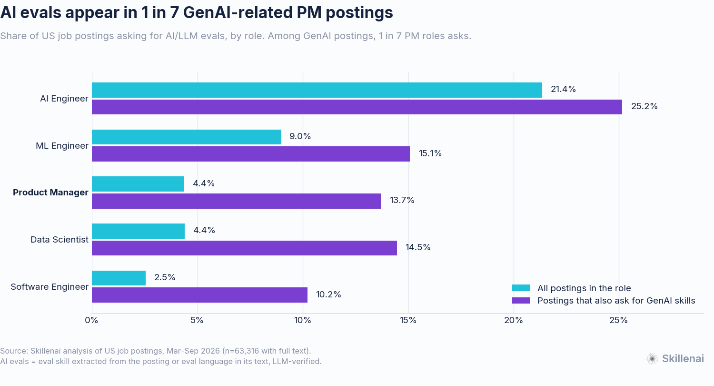
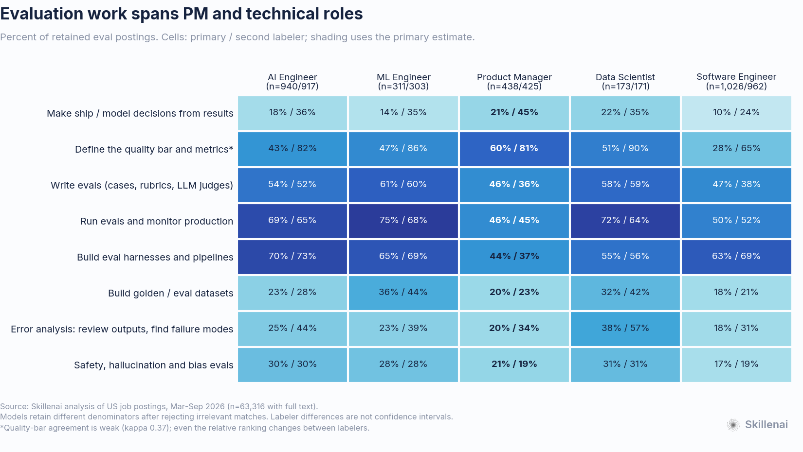
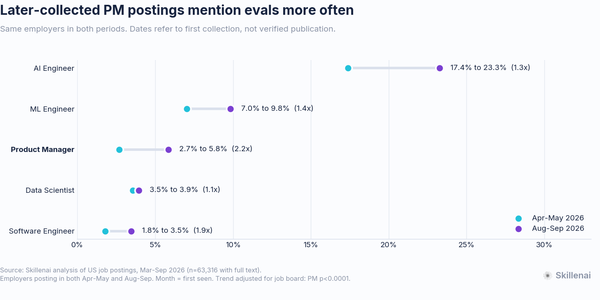
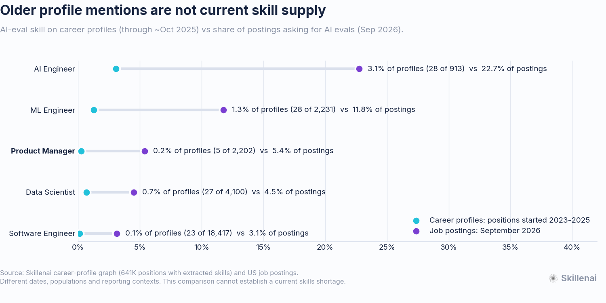

# Do PMs Need AI Evals? What 63,316 Job Postings Say

For a product manager targeting generative-AI work, **designing and writing evaluations is one concrete skill employers ask for**. In our September 2026 analysis, about one in seven PM postings that mentioned GenAI skills also requested AI evaluations. Where PM postings requested evals, roughly four in five asked for hands-on work.

That is a specific answer to “which skills matter for AI PMs?” It is not a ranking of all AI PM skills, and it does not show which skills cause someone to get hired.

We examined **63,316 US job postings with full descriptions**, including **10,105 product-management postings**, first collected from March through September 2026. The analysis was prompted by Hamel Husain and Shreya Shankar’s September 22 [guide to advanced evaluations](https://www.lennysnewsletter.com/p/advanced-evals-how-to-find-and-fix). Here we focus on what employers explicitly request.

## Where PMs are asked for evaluations

| Role family | Postings | Request AI evals | Request AI evals among postings mentioning GenAI skills |
|---|---:|---:|---:|
| AI Engineer | 4,410 | 21.4% | 25.2% |
| ML Engineer | 3,469 | 9.0% | 15.1% |
| Product Manager | 10,105 | 4.4% | 13.7% |
| Data Scientist | 3,973 | 4.4% | 14.5% |
| Software Engineer | 41,359 | 2.5% | 10.2% |

Among **2,687 PM postings mentioning GenAI skills**, 13.7% requested AI evals. Across the full PM group, 442 postings did so. The PM and data-science percentages are similar; that is not evidence that the roles have identical requirements.

The PM family includes technical, senior and AI-specialized variants. “Mentions GenAI skills” is our operational definition, not a verified classification of the product the team builds. These results describe this US posting corpus, not all PM vacancies.

## What hands-on means

We extracted evaluation sentences and used two independent labeling models to classify the responsibilities assigned to the hire. Both found that most PM evaluation requests involved doing the work: **79.0% and 81.9%**.

The exact mix was less certain. Below are both models’ estimates, rather than treating either as ground truth.

| Responsibility in PM postings requesting evals | Primary labeler | Second labeler |
|---|---:|---:|
| Write evals: cases, rubrics or LLM judges | 46.1% | 35.5% |
| Run evals and monitor production | 46.3% | 44.9% |
| Build eval harnesses and pipelines | 43.6% | 37.2% |
| Review outputs and identify failure modes | 19.6% | 34.4% |
| Build evaluation datasets | 19.9% | 22.6% |
| Safety, hallucination and bias evaluations | 21.0% | 19.1% |

These percentages are conditional on requesting evals, **not percentages of all AI PM postings**. The labelers retained different sets after rejecting irrelevant matches: 438 PM postings for the primary labeler and 425 for the second. Their differences reflect both classification and inclusion decisions. Ranges between them are sensitivity checks, not confidence intervals.

For a PM portfolio, this suggests a practical demonstration: take an AI feature, assemble representative cases, write a scoring rubric, inspect failures, and explain how the results inform a product decision. That is our application of the findings, not a measured hiring advantage.

## The responsibilities overlap across roles

Error analysis appeared more often in data-science postings requesting evals than in PM postings under both labelers: **37.6% versus 19.6%**, and **56.7% versus 34.4%**. That supports a relative difference in advertised responsibilities. It does not establish that error analysis belongs to data scientists or that PMs do not do it.

Both labelers also put PMs below the technical roles on building evaluation infrastructure and running or monitoring evaluations. Some other comparisons were unstable: the models disagreed on whether PMs led in defining the quality bar. We therefore do not claim a distinctive PM advantage there.

## A higher rate in later-collected postings

Among employers represented in both collection periods, the share of PM postings requesting evals was **2.7% for postings first seen in April–May and 5.8% for those first seen in August–September 2026**. The all-employer comparison also rose, from 3.2% to 4.7%. The saved job-board-adjusted models reported p<0.0001 for the PM trend.

This is a **first-seen-date comparison**, not a verified timeline of when employers published jobs. Matching employers and adjusting for job board reduce some composition differences, but do not eliminate changing collection coverage, posting age or within-employer role mix. The result suggests increased visibility of eval requirements in this corpus; it does not establish that market-wide demand doubled in four months.

## Older profiles cannot establish a current skills shortage

The earlier analysis also found an AI-eval skill in **5 of 2,202 PM positions started in 2023–2025**, among positions with at least one extracted skill. Those profiles covered employment history through roughly October 2025; the posting comparison comes from 2026.

These sources differ in date, population and purpose. A profile’s failure to mention a skill does not establish that the person lacks it. We retain the comparison for transparency, but it cannot show a current shortage, a supply–demand ratio, or that a candidate with eval skills will stand out.

## What to take away

If you are targeting PM roles involving GenAI, **be ready to demonstrate how you evaluate an AI feature**, rather than relying only on familiarity with evaluation terminology. The evidence is strongest for a bounded statement: evals appear in a minority of these postings, and the postings that ask for them usually describe hands-on work.

This study does not rank evaluation above product strategy, customer discovery, analytics or other AI skills. It also does not measure AI PM hiring growth or hiring outcomes.

Our published companion, [Stop Saying “This Is Not a Research Role.” Start Hiring for Evals.](https://skillenai.com/2026/09/23/stop-saying-this-is-not-a-research-role-start-hiring-for-evals), examines technical roles using a broader evaluation definition that includes classic model evaluation. Its percentages should not be treated as interchangeable with these AI/LLM-specific results.

## Methodology and limits

- **Snapshot:** analysis dated September 23, 2026; editorial revision October 28, 2026. No new data collection or model fitting was performed for this revision. Of 74,857 US postings in five role families, 63,316 had at least 500 characters of description text. Role families use normalized titles; product marketing is excluded. A known employer posting near-identical jobs across many locations is excluded.
- **Detection:** either an extracted AI-eval skill or AI-eval language in the description, followed by rejection of irrelevant matches. Plain “model evaluation” is excluded to avoid counting classic ML validation. The skills-only and text-only PM measures were 2.9% and 3.9%; the combined measure was 4.4%. A saved manual check found 30 of 30 sampled PM matches relevant. These instruments use the same underlying postings and are not independent samples.
- **Responsibilities:** categories were developed from a sample of 300 postings. The saved pipeline labeled 3,041 candidate evaluation postings with two models; each rejected irrelevant matches separately. The model-specific retained denominators are recorded in the accompanying CSVs. The saved analysis reports Cohen’s kappa of 0.59–0.84 for seven responsibility categories, 0.60 for hands-on versus familiarity, and 0.37 for defining the quality bar. No sampling confidence intervals are supplied here; the between-labeler ranges are not substitutes for them.
- **Timing:** first-seen month, with March’s initial collection backlog excluded from trend tests. Models adjusted for job board, including a comparison restricted to employers present in both periods. Collection dates remain an imperfect measure of posting dates.
- **Coverage:** the corpus under-represents employers using proprietary job boards. Inclusion by role title reduces dependence on AI wording but does not make this a representative sample of all US vacancies. Postings describe advertised requirements, not actual work, unique hiring decisions or successful hires. Labeling errors may differ across roles; using two models does not remove that risk.

[Analysis materials, code and result tables](https://github.com/skillenai/skillenai-notebooks/tree/pm-evals-2026/pm-evals-2026)
